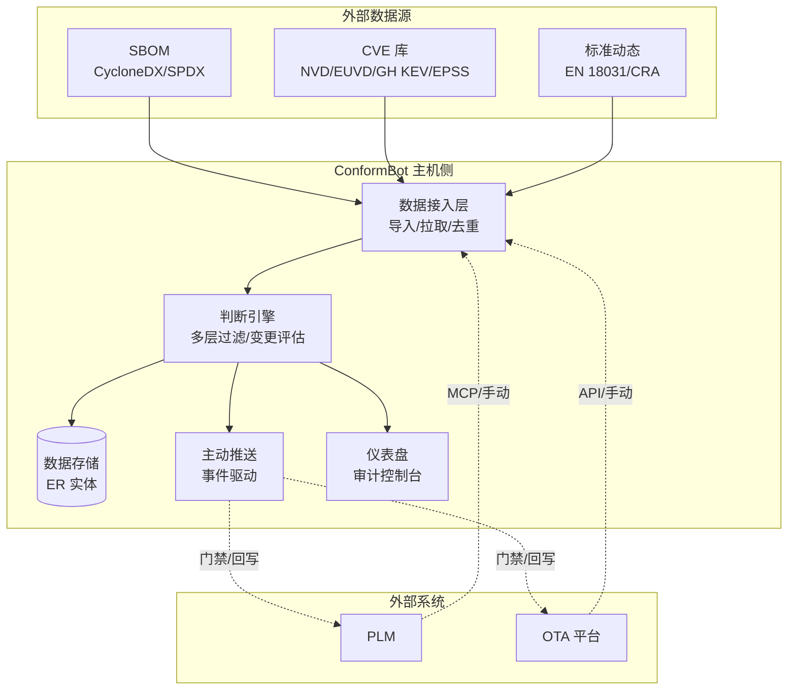
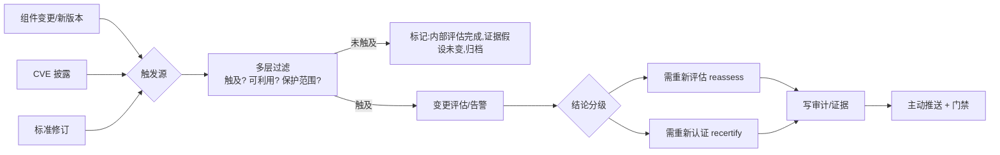

# 项目概述与架构

> 【源自项目文档】 的内容取自早期规划文档《ConformBot_项目文档.md》（其内容**已全部并入本套文档**，见 §十四–§十六及附录）；【建议/待确认】 的为建立骨架所做的合理推演。
> 阅读顺序上，本文是理解全项目的第一入口；产品内核见 `04-数据模型与判断逻辑.md`。

## 一、项目定位【源自项目文档】

**ConformBot 不是扫描器，也不是认证机构，而是一个「合规判断引擎」——一个持续在岗的值守代理。**

它消费厂商已有的 SBOM（来自 SCA 工具或 CI/CD），在 EN 18031 / CRA 等条款下，持续判断「每一次组件变更、每一次 OTA、每一个新披露的 CVE，是否触碰了合规规则、是否需要重新评估」，并把每一次判断留下可审计的证据。

品牌名 **ConformBot**（中文传播名建议：合规值守官），技术代号同名 `ConformBot`（仓库与内部模块命名统一采用此名，不再单设代号）。

## 二、产品身份：它是一个 Bot，不是一个工具【源自项目文档】

这是本项目最容易被自己在迭代中弄丢的一点，必须写在最前面。

### 2.1 身份漂移的风险

项目推演一路在做减法：绕开重型平台 → 不碰固件 → 不做平台 → 收敛为「极轻的判断微服务（API / CLI / 极简界面）」+「日常静默的仪表盘」。**这个终点的工程外壳，看起来就是一个普通应用。** 一旦因此把自己当成工具，会输在最想赢的那个维度上。

### 2.2 Bot 的三性（必须守住）

Bot 从来不是指"聊天窗口"。它指三个属性，而这三个恰好是这个产品唯一的根：

| 属性 | 含义 | 在产品中的体现 |
| :--- | :--- | :--- |
| **主动** | 系统来找你，而非你来找它 | 事件驱动推送；认证机构拿完证就走，"有人一直盯着"是存在理由 |
| **自主** | 在边界内自行动作 | 自动标记需重评估、生成漏洞工单、OTA 发布前设合规门禁 |
| **在场** | 7×24 持续值守 | "认证机构走了，但有人留下"——这是订阅定价的理由 |

### 2.3 与「普通应用」的差别（决策参照）

| 维度 | ConformBot（Bot 身份） | 普通应用 / 工具 |
| :--- | :--- | :--- |
| 发起方向 | 系统主动找你，事件驱动 | 你打开才能看到，拉取式 |
| 自主性 | 边界内自行动作 | 只执行你的指令 |
| 心智模型 | 一个在岗的人（替代外包合规专员） | 一款软件工具 |
| 定价锚点 | 订阅 / 服务定价（对标外包 PSIRT €3,500–6,000/年） | 一次性 / 低价 SaaS（被免费工具压价） |

### 2.4 结论

> **形态可以极简，身份必须是 Bot。**
> 界面是它的"审计控制台"，不是它的主入口。**不要把"Bot"理解成"聊天机器人"**——B2B 合规买方要的是证据链和审计轨迹，不是对话框。

## 三、背景与机会【源自项目文档】

### 3.1 一个正在爆发、但安全真空的市场

- **AI 玩具**：2025 年中国市场规模约 290 亿元，2026 年预计 342 亿元，2030 年预测破千亿；全球 312 亿美元，中国占 36% 以上。两年融资超 50 起。
- **AI 硬件**（除手机/汽车）：2026 年中国消费级市场规模预计突破 1.27 万亿元；端侧 AI 芯片出货同比增长 78%。
- **安全却是真空**：团队擅长毛绒、语音交互、IP 联名，但不懂云端鉴权、数据加密、漏洞响应。

### 3.2 已发生、公开、有政治级别关注的事故

| 事件 | 时间 | 要点 |
| :--- | :--- | :--- |
| Miko 3 被美国参议员调查 | 2026.02 | 儿童与玩具的数千条对话录音被放在公开可访问的数据集里 |
| Eiliko 陪伴机器人被 The Verge 曝光 | 2026.10 | 约 1300 万段对话、约 68000 台玩具数据未保护；研究人员从地球另一端改写玩具「记忆」；厂商一个月沉默、承诺修复后漏洞仍在 |

**结论**：爆发速度远超厂商安全能力；厂商「知道了问题也无力整改」是结构性的，不是态度问题。

### 3.3 外部压力已经到来（真正的付费驱动力）

- **EN 18031 系列**：2025 年 8 月 1 日起强制，是联网无线电设备进入欧盟的**市场准入条件**（必须 CE 标志才可上市）。
- **CRA（网络弹性法案，Regulation (EU) 2024/2847）**：2027 年 12 月 11 日全面适用，覆盖所有带数字元素产品，要求**全生命周期**漏洞管理。
  - 第 14 条漏洞报告义务**自 2026 年 9 月 11 日生效**：发现被积极利用漏洞须 24 小时预警、72 小时详报 ENISA + CSIRT。
  - 罚款上限：全球年营业额 2.5% 或 1500 万欧元。
- **英国 PSTI、IEC 62443、GDPR、EU AI Act**：视产品与市场叠加适用。

> 关键判断：厂商不是「想买」，是「不得不买」——不通过认证就进不了市场。

## 四、目标客户【源自项目文档】

**核心画像**：有出海欧盟计划、团队精简（通常只有 1–2 名嵌入式工程师、无专职安全/合规人员）、对 EN 18031 / CRA 合规有持续判断需求的中小 AI 硬件 / 玩具厂商。

| 口径 | 数量级 |
| :--- | :--- |
| 国内「智能玩具相关」现存企业 | 约 2,441 家（制造业约 500+） |
| 全球消费级 AI 硬件创业公司 | 约 117 家（中国约 80–90 家） |
| 欧盟海关抽查合规率 | 中国出口无线电设备仅 32% 符合 EN 18031 新规 |
| **可触达的目标客户池** | **数百家量级**（华南占近六成，深圳/东莞为高密度产业带） |

**结论**：这是一个「小而深」的市场——足以支撑一个极轻量、低成本的产品，**不足以**支撑需要重销售、重实施的企业级平台。

## 五、核心问题：所有人都缺的「翻译层」【源自项目文档】

无论大企业还是中小企业，现有方案共同缺失的，是把**外部 CVE 信息翻译成内部合规行动指令**的那一层：

| 角色 | 大企业（有平台） | 中小企业（有人/外包） |
| :--- | :--- | :--- |
| 工具/人力 | Finite State、Cybellum，或开源 Dependency-Track | 兼职工程师，或外包 PSIRT 前端（约 €3,500–6,000/年起） |
| 产出 | 一份 CVE 列表和风险评分 | 一份手动整理的 CVE 清单 |
| **缺失环节** | 从「CVE 列表」到「EN 18031 合规行动项」的**翻译** | 同左 |
| ConformBot 定位 | 嵌入现有工具链的**自动化合规判断引擎** | 低成本的「虚拟安全合规专员」 |

> 大企业不缺「眼睛」，中小企业不缺「手」，两者都缺一个能持续把外部信息翻译成合规动作的「大脑」。

## 六、方案演进（为什么最终收敛为「判断引擎」）【源自项目文档】

| 阶段 | 方案 | 被否定的原因 |
| :--- | :--- | :--- |
| ① 硬件安全方案 | 面向厂商的「安全能力补位」（4 模块） | 模块一被云平台覆盖；模块三/四只能作增值 |
| ② 设备端安全 SDK | 加密通信 + 指令签名 + 本地加密存储 | SDK 在采购决策树上无落点 |
| ③ 预认证安全模组 | 模组已过 RED 认证，整机可复用报告 | 偏硬件供应链，非软件切入点 |
| ④ 端到端认证服务 | 对「拿到证书」负责 | 需与持牌机构正面竞争，不现实 |
| ⑤ 持续合规托管 Bot | 守住「拿证之后」的合规状态不退化 | **成立**——「持续在场」的角色是空的 |
| ⑥ 极轻合规判断引擎 | 只做「变更 → 合规结论」的判断 | **最终定位**——绕开重型平台，低摩擦 |

**关键洞察**：SDK 能否卖动，不取决于厂商是否「相信它能过认证」，而取决于**尝试成本是否低到不值得犹豫**。低尝试成本把「信任门槛」转化成「工程师的周末实验」。

## 七、明确不做的事（边界）【源自项目文档】

ConformBot 卡在「安全合规」这个垂直切面上，不替代任何既有系统：

| 层级 | 系统 | 管什么 | 不管什么 |
| :--- | :--- | :--- | :--- |
| 设计态 | **PLM** | 全量 BOM、ECN、版本基线、供应商信息 | 不跟踪 CVE，不判断合规影响 |
| 运维态 | **OTA 平台** | 固件推送、设备分组、回滚执行 | 不维护 BOM，不做合规判定 |
| **合规态** | **ConformBot** | 安全 BOM 子集 + CVE/标准监控 + 变更合规判定 + 证据归档 | 不替代 PLM 主数据，不替代 OTA 推送管道 |

- **对 OTA**：只管「安全证据链」，不管「推送管道」。
- **对 BOM**：只管「安全相关子集」，不管「全量物料」。
- **守护对象**：不是 SBOM 本身，而是**已上市产品在支持期内的合规状态连续性**。
- 不承诺赔付、不承诺「用了就一定过认证」（EN 18031 首次失败率 40%–60%，任何工具都覆盖不了全部变量）。
- 第一版不支持远程授权式集成、不建重型平台；不做跨框架告警的自动合并/抑制（见 `04` §九）。

## 八、系统组成【建议/待确认】

系统由四个端构成，围绕「外部数据源 + 内部判断」展开：

| 组件 | 职责 | 形态 |
| :--- | :--- | :--- |
| **数据接入层** | SBOM 导入、变更事件录入、外部 CVE/标准拉取与去重 | 服务/作业 |
| **判断引擎** | CVE→合规多层过滤、变更性质识别、结论分级、证据结构化 | 核心服务（规则 + LLM） |
| **数据存储** | ER 实体持久化、审计记录、证据链 | DB |
| **主动推送** | 按 BOM/框架过滤、事件驱动推送、门禁/回写 | 服务 |
| **仪表盘** | 状态、告警、工单、审计入口（**副入口**） | Web 前端 |

## 九、分层架构【建议/待确认】

参照 barkguard 的分层方式，本系统分五层：

| 层级 | 名称 | 职责 | 关键技术 |
| :--- | :--- | :--- | :--- |
| L1 | 交互层 | 仪表盘、合规看板、变更评估、工单、审计视图 | React + Tauri/Web |
| L2 | 判断引擎层 | 多层过滤、变更性质识别、结论分级、证据结构化 | Python/Rust + LLM 调用 |
| L3 | 数据模型层 | ER 实体、状态机、审计与证据链 | ORM/SQLite/PostgreSQL |
| L4 | 数据接入层 | SBOM 解析、变更事件、CVE/标准拉取、去重 | CycloneDX/SPDX 解析器、任务调度 |
| L5 | 外部数据源层 | NVD/EUVD/GitHub Advisories/CISA KEV/EPSS、标准动态 | API/镜像同步 |

## 十、核心工作流【建议/待确认】

关键点：

1. **判断不简化为「CVSS 高就影响」**（见 `04` §四）。
2. **多框架独立告警**：同一 CVE 触碰多个框架 → 多条独立告警，不合并（见 `04` §九）。
3. **审计必写**：任何判断结论都要落证据，不论结论为「未触及」还是「需重评估」。

## 十一、技术栈总览【建议/待确认】

| 层级 | 选型（候选） | 说明 |
| :--- | :--- | :--- |
| 判断引擎 | Python（规则）+ 可选 Rust 内核 | 生态成熟、便于 LLM 编排 |
| SBOM 解析 | CycloneDX / SPDX 官方库 | CRA 推荐、原生支持 VEX |
| LLM | 本地部署开源 LLM（Qwen 27B 级） | 文档不外传、评估员终裁 |
| 存储 | PostgreSQL（生产）/ SQLite（本地） | ER 实体 + 审计 |
| 前端 | React + Vite + Tailwind | 亮色 SaaS 后台风格 |
| 图表 | ECharts | 健康度、时间线、统计 |
| 集成 | MCP（PLM）、hawkBit REST（OTA）、webhook | 分阶段对接 |

### 前端（仪表盘）技术选型【建议/待确认】

| 组件 | 选型 | 说明 |
| :--- | :--- | :--- |
| 框架 | React 18 + Vite | 与现有生态一致 |
| UI 库 | Tailwind CSS（+ 组件库） | 现代化、可定制 |
| 状态管理 | React Context + useReducer | 轻量级 |
| 图表 | ECharts | 健康度色标、SLA 进度条、审计时间线 |

## 十二、信任边界与合规边界【建议/待确认】

| 主体 | 信任假设 |
| :--- | :--- |
| 外部 CVE/标准数据源 | **部分信任**——需去重、需版本留痕，结论须可回溯到数据点 |
| SBOM 输入 | **不被信任**——可能不全、可能过期；只作为「成分基线」 |
| LLM 初判 | **不被信任为终裁**——只产出「带依据的初判」，最终判断归制造商 |
| 制造商的合规确认 | **被信任**——GEC-1 的最终可利用性判断由制造商结合产品语境确认 |
| 审计与证据 | **须不可篡改**——判断留痕、可校验、AI/外部不可改 |

合规边界红线：

1. **GEC-1 最终「可利用性」判断不能完全自动化**，引擎只能做初判 + 证据结构化，不越位替代最终判断。
2. **不承诺赔付、不承诺包过**——结论是「带依据的判断」，不是担保。

## 十三、术语表【建议/待确认】

| 术语 | 含义 |
| :--- | :--- |
| SBOM | 软件物料清单（Software Bill of Materials），CycloneDX / SPDX 为主要格式 |
| VEX | 漏洞可利用性交换（Vulnerability Exploitability eXchange） |
| CRA | 欧盟网络弹性法案（Cyber Resilience Act，Regulation (EU) 2024/2847） |
| EN 18031 | 欧盟联网无线电设备安全标准系列，市场准入条件 |
| GEC-1 | EN 18031 中关于「公开已知可利用漏洞」的要求项 |
| 静默修复 | 无 CVE、无公告、无 changelog 的开源安全修复 |
| NB 证书 | 公告机构（Notified Body）证书 |
| SCA | 软件成分分析（Software Composition Analysis） |
| reassess / recertify | 判断结论分级：需重新评估 / 需重新认证 |
| 判断微服务 | ConformBot 的工程形态：API / CLI / 极简 Web，只做判断 |

## 十四、命名决策记录（ConformBot）【源自项目文档】

### 14.1 命名历程

| 阶段 | 名字 | 说明 |
| :--- | :--- | :--- |
| 早期 | 大黄 / BarkGuard | 偏「亲民/看门狗」气质，与 U 盘密钥类产品匹配（**前一项目遗留，已弃用**） |
| 第 134 轮 | ComplianceLens | 「合规透镜」，自解释、工程感强 |
| 第 135 轮 | EuroScan Compliance | 同时承载「欧洲合规」+「漏洞扫描」 |
| 第 136 轮 | EuroScan（缩写） | 保留 Euro + Scan |
| 第 137 轮 | ⚠️ EuroScan（撞名严重） | ORBCOMM 冷链温度记录仪、德国 EuroScan 医疗评估网络（euroscan.org）、验钞机等——搜索可见性被严重稀释 |

### 14.2 命名约束（后续讨论确立）

1. 品牌名必须**包含 `bot`**，以承载「Bot 而非工具」的身份（见 §二）。
2. 必须避开**已被占用的通用词 + Bot**。
3. 必须避开**法定/通用缩写**（如 CVE、DoC）——显著性弱、易暗示官方关联。
4. 必须避开**有同音歧义**的词（如 DoC 与 doc 同音）。
5. 语义应贴合**欧盟合规的核心动作**，而非某个具体产物或扫描动作。

### 14.3 候选筛查记录（网络可见性初筛）

| 候选 | 撞名情况 | 结论 |
| :--- | :--- | :--- |
| ComplyBot | complybot.eu 即 GDPR 合规平台，领域几乎重合 | ✗ |
| ClauseBot | 焊接行业 + 法务合同分析在用 | ✗ |
| NormBot | Norm Ai（法律合规 AI 公司）+ GitHub 同名安全 agent | ✗ |
| WardenBot | Discord 管理 bot 等一批 | ✗ |
| GatekeeperBot | GatekeeperAI 已是 AI 审核 bot，另有 AI agent 编排平台 | ✗ |
| BarkBot | barkbot.com（犬业营销）+ Solana 交易 bot | ✗ |
| CertBot | Let's Encrypt 的 Certbot，禁区 | ✗ |
| VigilBot | runvigil.ai 即「AI 行为守门 + 审计链」平台，概念近到危险 | ✗ |
| CVEBot | `CVE®` 是 MITRE 注册商标；`cve-bot` 已被大量开源项目占用；且把定位拉回"漏洞推送工具" | ✗ |
| DoCBot | `DoC` 与 `doc` 同音（会被听成"文档机器人"）；docbot/DOCBOT/Dokobot 已是现成产品 | ✗ |
| AttestBot | attest（存证/符合性证明）语义精准、未检索到同名产品；但在欧盟产品合规文书里不是首选词 | △ 备选 |
| **ConformBot** | **未检索到同名产品；取自 conformity（欧盟合规的法定核心词，DoC 即其产物）** | **✓ 采用** |

> 备查：`attest` / `attestation` 在**软件供应链安全**（in-toto attestation、SLSA provenance attestation、Sigstore `cosign attest`）与**安全审计**（SOC 2 attestation report、NIST SSDF self-attestation）语境里是一等术语，但在**欧盟产品合规文书**里不是首选词——那边用 **EU Declaration of Conformity（DoC）** 与 **conformity assessment**。本项目核心战场是后者，故最终选 ConformBot。

### 14.4 为什么是 ConformBot

1. **语义覆盖完整**：欧盟合规整套术语都长在 `conformity` 上——*conformity assessment*（符合性评估）、*presumption of conformity*（合规推定）、*declaration of conformity*（即 DoC）。覆盖的是"动作"，而非"一张纸"。
2. **没有同音歧义**：不像 DoCBot 会被听成"文档机器人"。
3. **显著性优于 DoCBot**：不碰 CVE / DoC 这类法定通用缩写（后者作为品牌名几乎不可注册）。
4. **心智与身份一致**：conform 是"符合"这个持续状态，天然贴合「持续合规、一直在岗」的 Bot 身份。
5. **无同名产品**，搜索可见性可立起来。

**客观提醒**：`conform` 是普通英文词，故 ConformBot 作为组合商标，显著性属**中等偏弱**——但仍明显优于 CVEBot / DoCBot。定名前仍建议去 **EUIPO / USPTO** 按类别做一次正式检索。

### 14.5 配套命名

- **品牌名**：ConformBot
- **中文传播名（建议）**：合规值守官
- **技术代号**：与品牌同名 `ConformBot`（不再单设代号；此前候选 `BarkGuard` 系前一项目遗留，已弃用）
- **Tagline 方向**：欧洲市场锚点（CRA / EN 18031）不塞进品牌名，用 tagline 表达，如 "EU compliance, watched over."

## 十五、风险清单【源自项目文档】

- **付费驱动力依赖法规时间表**：EN 18031 已强制，CRA 全面适用在 2027.12，窗口期内厂商可能仍在「赌不被曝光」。
- **客户密度**：市场小而深（数百家），需靠低摩擦触达而非销售团队攻克。
- **重型平台下探**：Finite State / Red Alert Labs 等已在做「持续监控」，需持续守住「极轻、聚焦判断」的差异。
- **判断的合规边界**：GEC-1 最终「可利用性」判断「不能完全自动化」，必须由制造商结合产品语境确认——ConformBot 只能做初判 + 证据结构化，不能越位替代最终判断。
- **身份漂移**：工程实现的"极轻"容易把自己做成工具，从而丢掉 Bot 的主动/自主/在场（见 §二），需在产品决策中持续对抗。
- **商标显著性**：ConformBot 组合商标显著性中等偏弱，需正式检索确认可注册性。

## 十六、关键假设与待验证问题【源自项目文档】

1. **付费意愿**：中小硬件厂商是否愿意为「只做判断、不做管理」的轻产品付费？还是觉得「自己的工程师想想也能做」或「已包含在重型平台/咨询公司里」？
2. **需求验证动作（低成本、不写代码）**：
   - 找 3–5 家只有 1–2 名嵌入式工程师、有出海欧盟计划的 AI 玩具/硬件厂商，问：
     - 「拿证之后，你们怎么跟踪 mbedTLS/wolfSSL 的 CVE？」
     - 「上次固件更新前，你们判断过它算不算‘重大变更’吗？」
     - 「如果有人报告你们产品漏洞，现在有流程接住吗？」
   - 若三个问题中有两个回答「没怎么管 / 不确定」，切入点成立。
   - 更具体地问工程师：「你现在有没有在写加密通信或指令签名？是自己写的还是用现成库？」——找那些**已经在动手、但动手很痛苦**的人。
3. **品牌名验证（5 分钟版）**：拿 "ConformBot" 问 3–5 个目标客户（做固件的工程师 + 管欧盟认证的人）——"看到这个名字，你觉得它是干嘛的？"验证自解释性。
4. **命名合规检索**：定名前在 EUIPO / USPTO 按类别做正式商标检索。

## 附录：来源与对话轮次索引（第 94–137 轮）【源自项目文档】

本节与全文所有【源自项目文档】标注，均来自早期规划文档《ConformBot_项目文档.md》（基于 DeepSeek 分享对话第 94–137 轮及后续命名讨论整理）；该原始文档的内容现已全部并入本套文档，无需再单独阅读。

| 轮次 | 主题 |
| :--- | :--- |
| 94 | 视野扩宽到 AI 硬件/玩具；3 个切口 |
| 95 | 3 切口指向同一产品；4 模块「安全能力补位」 |
| 96–98 | 模块二（设备端 SDK）可独立成立；EN 18031 认证流程与费用 |
| 99–105 | SDK 采购逻辑的死结；尝试成本论证；免费 SDK 的存在与缺口；「包过」不可承诺；最终否定 SDK 路线 |
| 106–108 | 引入 Bot 思维；持续合规运维 + 漏洞响应托管合并；不承诺赔付 |
| 109 | 前端 HTML 界面原型（第一版） |
| 110–121 | OTA/BOM 管理深度；与 PLM 关系；CVE 判断逻辑；SBOM 组件数量级；现状方案空白；华为 SCA 工具对比；静默修复；升级义务边界；守护范围界定 |
| 122–124 | ER 实体关系图；带交互的 HTML 原型；产品维护方式（SBOM 基线 + 变更事件） |
| 125–133 | 修复后是否重审；主动 vs 被动合规；SBOM 简化策略；市场上已有的重型平台；中小企业现状与规模；EN 18031 之外的法规矩阵；AI 的相关性；信号频次估算；多框架独立告警原则 |
| 134–137 | 命名：ComplianceLens → EuroScan Compliance → EuroScan → 撞名风险 |

### 后续讨论（非对话轮次）

- **定位复盘**：确认产品身份应是 **Bot**（主动 / 自主 / 在场），而非普通应用。
- **命名重构**：要求名称含 bot；筛查 10+ 候选后定名 **ConformBot**（详见 §十四）。
