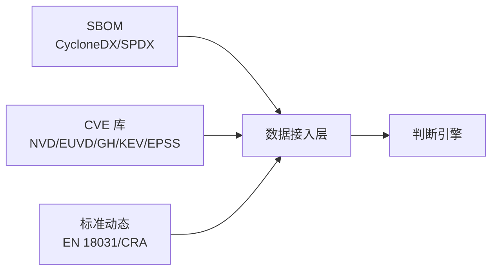

# 开源项目与数据源整合清单

> 本文档定义 ConformBot 的**输入从哪来**、可复用的组件/参考实现、整合方式与优先级。
> 标注 【源自项目文档】 源自早期规划文档（已并入本套文档；§ 指其原章节号，如 §7.3 / §8 / §10）；标注 【建议/待确认】 为推演。

## 一、输入数据源总览【源自项目文档】

ConformBot 的输入分三类（§10.1）：

| 类别 | 内容 | 格式/来源 |
| :--- | :--- | :--- |
| **SBOM** | 厂商已有的成分清单 | CycloneDX / SPDX |
| **CVE 库** | 漏洞情报 | NVD / EUVD / GitHub Advisories / CISA KEV / EPSS |
| **标准动态** | 标准修订与过渡期截止日 | EN 18031、CRA 的修订 |

## 二、SBOM 格式与解析【源自项目文档】

- **CycloneDX / SPDX** 为两大主流格式；CRA 推荐，**原生支持 VEX**，与 CVE 监控引擎天然对齐（§10.1）。
- ConformBot **消费**厂商导出的 CycloneDX/SPDX SBOM 作为输入（§8：华为 CodeArts/SBOM 回答「有没有已知漏洞」，ConformBot 消费其导出的 SBOM）。
- 仅解析**安全相关子集**（见 `04` §三），版本精确到补丁级。

| 格式 | 支持 | 说明 |
| :--- | :--- | :--- |
| CycloneDX | ✅ 首期 | JSON/XML；支持 VEX、组件 purl |
| SPDX | ✅ 首期 | tag-value / JSON |
| CSV / Excel | ✅ MVP 手动导入 | 一阶段降级路径 |

## 三、CVE 与漏洞情报库【源自项目文档】

| 数据源 | 用途 | 在判断中的角色 |
| :--- | :--- | :--- |
| **NVD** | CVE 基础信息、CVSS | 组件匹配后的基础信息 |
| **EUVD** | 欧盟漏洞数据库 | 欧盟视角补充 |
| **GitHub Advisories** | 开源生态漏洞 | 依赖库覆盖 |
| **CISA KEV** | 已知被利用漏洞目录 | 匹配 §四「可利用」证据 |
| **EPSS** | 漏洞被利用概率 | **仅作优先级排序**，非唯一依据 |

> 判断原则见 `04` §四：组件匹配 + 公开利用证据 + 保护范围三者共同决定状态标签；CVSS/EPSS 只排序。

## 四、静默修复检测方法【源自项目文档】

研究显示**高达 50% 的开源安全修复是「静默」的**。可集成的检测方法（§7.3）：

| 方法 | 原理 | 成熟度/备注 | 集成方式（建议） |
| :--- | :--- | :--- | :--- |
| **Fixseeker** | 代码属性图 | 覆盖多代码块关联修复 | 关键组件新版本触发分析 |
| **SPDAgent** | 二进制固件伪代码 diff | 准确率 73.44% | 有固件二进制时适用 |
| **Lacuna** | npm/Maven/PyPI 版本对比 | 约每 6 次更新 1 次含未披露修复 | 依赖库版本对比 |

**作用**：把「无 CVE 但含安全修复」的更新标记为「静默安全修复」，提示评估——覆盖 SCA 盲区。

## 五、可参考/复用的现有工具【源自项目文档】

| 现有方案 | 它做什么 | ConformBot 的关系 |
| :--- | :--- | :--- |
| 华为 CodeArts Governance / SBOM | 上线前扫描、生成 SBOM、CVE 关联、门禁、VEX | **消费**其导出的 CycloneDX/SPDX SBOM 作为输入 |
| OWASP Dependency-Track | 开源 SBOM 漏洞监控「仪表盘」 | 借鉴其 SBOM 监控；它不回答「是否触发合规重评估」 |
| Finite State / Cybellum / VicOne / Red Alert Labs | 企业级重型平台 | **不采用**——重实施、瞄准大 OEM；ConformBot 只做判断 |
| SGS / TÜV / 蓝亚 | 端到端「帮你拿证」 | **互补**——ConformBot 覆盖「拿证之后」 |

## 六、PLM 对接【源自项目文档】

| 阶段 | 对接方式 |
| :--- | :--- |
| 一（MVP） | 手动导入导出安全相关 BOM 子集（CSV/Excel） |
| 二 | 优先走 **MCP（模型上下文协议）**——beCPG 等 PLM 已提供 MCP Server |
| 三 | 按客户需求做 webhook/API 双向集成（判断结果回写 ECN） |

## 七、OTA 对接【源自项目文档】

| 阶段 | 对接方式 |
| :--- | :--- |
| 一（MVP） | 手动录入本次 OTA 的版本号、变更内容 |
| 二 | 接入 OTA 的 **Management API**（Eclipse hawkBit 的 REST API 已成事实标准） |
| 三 | webhook/API 双向集成（OTA 发布前合规门禁） |

## 八、LLM 选型【源自项目文档】

- 剥离「AI」标签，本质是「规则 + 外部数据的判断引擎」，传统工程可实现。
- AI 的价值在于处理**判断的模糊性**与**文档语义**（§10.3）：
  - 参考都灵大学 2025/2026 论文：本地部署开源 LLM 阅读标准条款 → 生成决策树 → 变自适应问卷 → 对每个资产给出 Pass/Fail/NA 并附文档出处 → 信息缺失时生成 RFI。
  - **中等模型（如 Qwen 27B）即可，可跑在厂商内部基础设施上，文档不外传**，最终决定仍由评估员做。

| 项 | 建议 |
| :--- | :--- |
| 模型 | Qwen 27B 级开源模型 |
| 部署 | 本地 / 厂商内部基础设施 |
| 数据 | 文档不外传 |
| 定位 | 产出「带依据的初判」，非终裁 |

**没有 AI** 只能做粗糙规则匹配（「升级加密库 = 重评估」）；**有 AI** 才能做「语义级变更影响分析」——这正是面对重型平台时「极轻判断工具」的立足点。

## 九、法规与标准动态跟踪【源自项目文档】

| 法规 | 关键节点 | 跟踪内容 |
| :--- | :--- | :--- |
| EN 18031 系列 | 2025-08-01 强制 | 修订、条款解释 |
| CRA §14 | 2026-09-11 生效 | 报告义务（24h/72h） |
| CRA 全面适用 | 2027-12-11 | 全生命周期漏洞管理要求 |
| 英国 PSTI / IEC 62443 / GDPR / EU AI Act | 视产品叠加 | 叠加适用判定 |

## 十、整合优先级矩阵【建议/待确认】

| 组件/数据源 | 优先级 | 集成方式 | 阶段 | 备注 |
| :--- | :--- | :--- | :--- | :--- |
| CycloneDX/SPDX 解析 | P0 | 库 | Phase 0 | SBOM 输入基础 |
| CSV/Excel 导入 | P0 | 自研 | Phase 0 | MVP 降级路径 |
| NVD + CISA KEV + EPSS | P0 | API/镜像 | Phase 1 | 多层过滤数据 |
| EN 18031 / CRA 条款库 | P0 | 自研（结构化条款） | Phase 1 | 判断依据 |
| EUVD / GitHub Advisories | P1 | API | Phase 1/2 | 覆盖补充 |
| MCP（PLM） | P2 | MCP Client | Phase 4 | 二阶段对接 |
| hawkBit REST（OTA） | P2 | REST Client | Phase 4 | 二阶段对接 |
| 静默修复（Fixseeker/SPDAgent/Lacuna） | P2 | 集成评估 | Phase 3 | 覆盖 SCA 盲区 |
| 本地 LLM（Qwen） | P2 | 本地推理 | Phase 3 | 语义级变更分析 |
