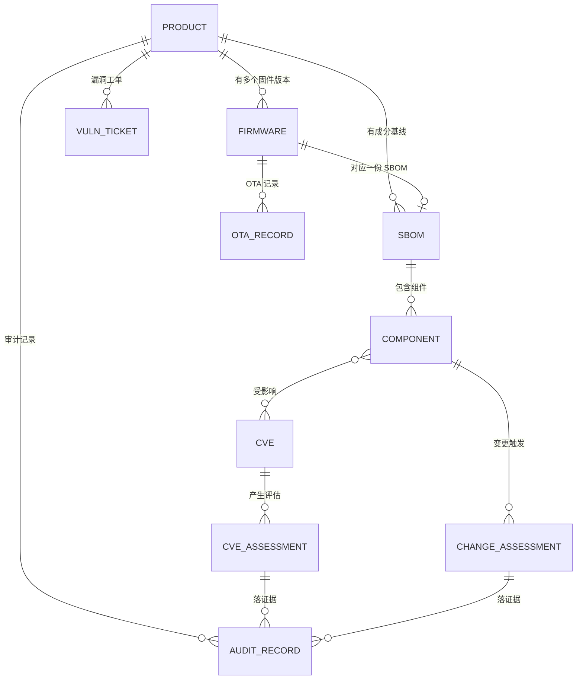
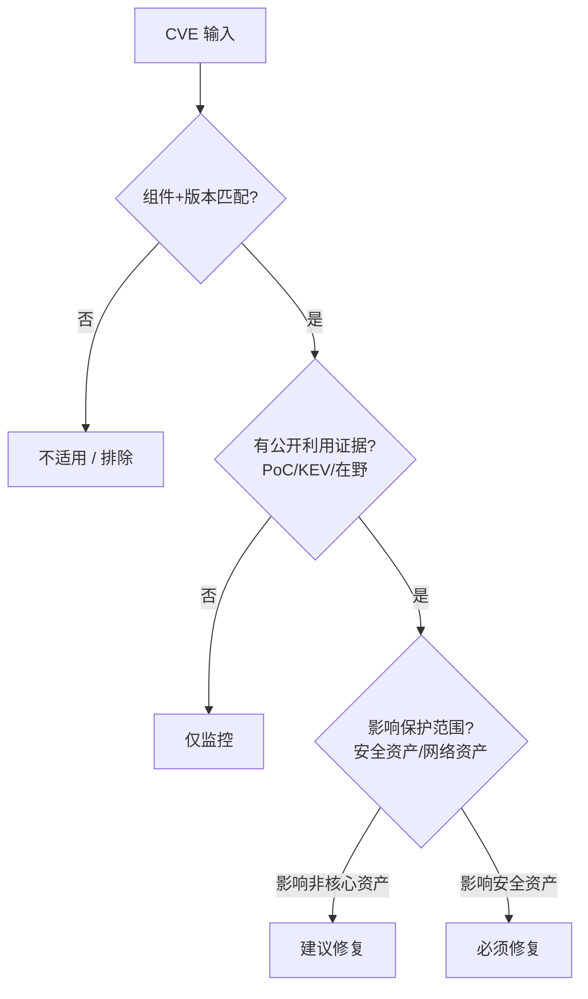
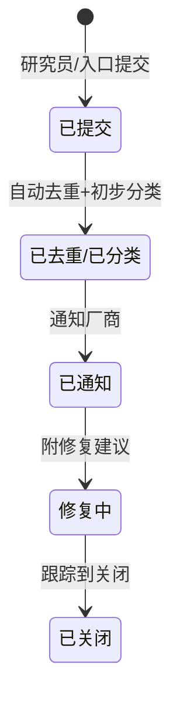

# 数据模型与判断逻辑（产品内核）

> 本文档是 ConformBot 的核心。标注 【源自项目文档】 的内容源自早期规划文档（已并入本套文档；§ 指其原章节号，如 §6.1③ / §7 / §9.2 / §9.3）；标注 【建议/待确认】 的为推演设计。
>
> 一句话：**判断引擎 = 数据模型（本文 §一–§三、§十）+ 判断逻辑（本文 §四–§九）**。

## 一、ER 实体模型【源自项目文档】

核心实体（第 122 轮）：`产品 · 固件版本 · SBOM · 组件 · CVE · CVE 评估 · 变更评估 · 漏洞工单 · OTA 记录 · 审计记录`。



| 实体 | 说明 | 关键字段（建议） |
| :--- | :--- | :--- |
| 产品 Product | 一个型号/产品线，合规守护的顶层单元 | id, name, model, market(EU), support_until |
| 固件版本 Firmware | 产品的一个发布版本 | id, product_id, version, released_at |
| SBOM | 某固件版本的成分基线（安全子集） | id, firmware_id, format(CycloneDX/SPDX), imported_at |
| 组件 Component | SBOM 中的一项（加密库/协议栈/依赖…） | id, sbom_id, name, version(到补丁级), type, purl |
| CVE | 一条漏洞情报 | id(cve_id), cvss, epss, kev(bool), sources |
| CVE 评估 CVE_Assessment | 对某产品，某 CVE 的合规判断结论 | id, cve_id, product_id, component_id, status, framework, evidence |
| 变更评估 Change_Assessment | 对一次变更的判断结论 | id, product_id, change_desc, touched, conclusion, nb_hint |
| 漏洞工单 Vuln_Ticket | 漏洞响应流程托管单元 | id, product_id, source, severity, status, sla_due |
| OTA 记录 OTA_Record | 一次 OTA/升级事件 | id, firmware_id, version, change_desc, recorded_at |
| 审计记录 Audit_Record | 判断留痕与证据 | id, ref_type, ref_id, conclusion, basis, prev_hash, hash, ts |

## 二、数据分层与维护方式【源自项目文档】

产品维护的输入是**分层**的（第 124 轮澄清）：

- **SBOM** 作为「**成分基线**」导入；
- **OTA / 升级包**作为「**变更事件**」录入。

二者共同驱动合规状态更新——不是「导入升级包」或「导入 SBOM」二选一，而是 **「SBOM 定义基线 + 变更事件触发判断」**。

```text
SBOM（基线）─┐
             ├─► 合规状态 ─► 判断结论 ─► 告警/门禁/审计
变更事件 ────┘
```

## 三、安全 BOM 子集模型【源自项目文档】

ConformBot **不管「全量物料」**，只纳入「影响设备安全属性或属 CRA 远程数据处理解决方案」的部分：

| 纳入类别 | 示例 |
| :--- | :--- |
| 加密库 | mbedTLS、wolfSSL、OpenSSL |
| 协议栈 | TLS/DTLS、MQTT、BLE、Wi‑Fi |
| 安全元件 | SE / HSM / TEE |
| OTA 签名组件 | 签名校验、安全启动链相关组件 |
| 开源依赖 | 第三方库（须能对应到 CVE） |

> 组件版本须精确到补丁级（如 `5.15.104`），否则匹配会失真。

## 四、CVE → 合规影响：多层过滤【源自项目文档】

判断**不能**简化为「CVSS 高就影响」。四层过滤：

1. **是否触及产品**：SBOM 组件 + 版本精确匹配（精确到补丁级）。
2. **是否存在公开可利用性证据**：PoC 代码、CISA KEV 收录、在野利用证据（对应 GEC-1 的「可利用」）。
3. **后果是否落在保护范围**：是否影响 EN 18031 保护的**安全资产**（密钥、凭据、隐私数据）或**网络资产**（通信通道、可用性）。
4. **CVSS 仅作优先级排序**，不是唯一依据。



### 输出状态标签【源自项目文档】

| 状态 | 含义 | 对 EN 18031 的意义 |
| :--- | :--- | :--- |
| **必须修复** | 组件匹配 + 有利用证据 + 影响安全资产 | 送审前必须处理（对应 6.10.1） |
| **建议修复** | 组件匹配 + 有利用证据 + 影响非核心资产 | 不直接致审失败，下次 OTA 处理 |
| **仅监控** | 组件匹配 + 尚无公开利用证据 | 记录在案，跟踪利用证据 |
| **不适用** | 组件或版本不匹配 | 排除 |

## 五、GEC-1 的「公开已知可利用漏洞」【源自项目文档】

- 「公开」**不限于 CVE 收录**——安全公告、研究论文、厂商博客、代码提交记录均算。
- 「可利用」需结合产品语境判断（攻击面、攻击路径、内置安全机制、运行环境），标准承认「特定条件下不可利用」或「经风险评估被接受」的例外。
- 因此 **SCA 扫描是必要但不充分的输入**，更细致的分析（可达性、静默修复检测、攻击面评估）是合规判断的必要输入。
- ⚠️ **最终「可利用性」判断不能完全自动化**，必须由制造商结合产品语境确认；引擎只做初判 + 证据结构化。

## 六、静默修复检测（覆盖 SCA 盲区）【源自项目文档】

研究显示**高达 50% 的开源安全修复是「静默」的**（无 CVE、无公告、无 changelog）。ConformBot 可在关键组件发新版本时触发「变更性质分析」，把无 CVE 但含安全修复的更新标记为 **「静默安全修复」**，提示评估。

| 可集成方法 | 原理 | 备注 |
| :--- | :--- | :--- |
| Fixseeker | 代码属性图 | 覆盖多代码块关联修复 |
| SPDAgent | 二进制固件伪代码 diff | 准确率 73.44% |
| Lacuna | npm/Maven/PyPI 版本对比 | 约每 6 次更新有 1 次含未披露修复 |

**触发条件**：关键组件发布新版本（无 CVE）→ 触发变更性质分析 → 判定是否含安全修复 → 标记「静默安全修复」。

## 七、变更评估引擎（产品内核）【源自项目文档】

厂商提交一次变更（如「mbedtls 从 2.28.1 升到 2.28.4」），引擎输出结构化结论：

```text
变更性质识别 → 是否触及加密算法/认证协议/OTA 签名/安全启动链
  ├─ 未触及：标记「内部评估完成，证据假设未变」，记录归档
  └─ 触及：  标记「需变更评估」，并按是否持有 NB 证书提示：
              「需向公告机构备案」/「可能需补充差异测试」
```

**结论分级**：`需重新评估（reassess）` / `需重新认证（recertify）`。

| 结论 | 触发条件（建议） |
| :--- | :--- |
| 内部评估完成（未触及） | 变更未触及加密算法/认证协议/OTA 签名/安全启动链 |
| 需重新评估 reassess | 触及安全相关面，但未改变已认证的安全主张 |
| 需重新认证 recertify | 触及安全主张/加密算法等，可能导致证书失效 |
| NB 备案提示 | 触及 + 持有 NB 证书 → 「需向公告机构备案」/「可能需补充差异测试」 |

## 八、多框架独立告警（重要设计原则）【源自项目文档】

**不做跨框架的自动合并或抑制。** 同一个 CVE 同时触发 EN 18031 的 GEC-1 判断和 CRA 的第 14 条报告义务，是**两个独立的合规事实**。用户看到两条告警不是「重复打扰」，而是「两个监管框架同时被触碰」这一真实状态的准确反映。

- **数据模型**：从「一个 CVE 一条告警」→「**一个 CVE 对每个被触碰框架各产生一条独立告警，各带依据与严重级**」。
- **界面**：支持按框架筛选、按严重级排序，但「同时触发」这个事实必须原样呈现。

```text
CVE-X ──► 告警(框架=EN 18031, 依据=GEC-1, 严重级=高)
       └─► 告警(框架=CRA §14,  依据=报告义务, 严重级=高)   # 两条并存,不合并
```

## 九、审计与证据模型【建议/待确认】

判断必须留下**可审计的证据**。建议采用 barkguard 的哈希链思路（只追加、哈希相连、可校验）：

| 字段 | 类型 | 说明 |
| :--- | :--- | :--- |
| seq | int | 自增序号 |
| ts | string(ISO8601) | 判断时间 |
| ref_type | enum | cve_assessment / change_assessment / ticket |
| ref_id | string | 关联实体 ID |
| conclusion | string | 判断结论（状态标签 / reassess / recertify） |
| basis | object | 依据：条款版本、数据点、命中规则 |
| framework | string | 被触碰框架 |
| prev_hash | string | 上一条哈希（首条全零） |
| hash | string | 本条 SHA-256 |

哈希链规则：`hash_n = SHA256(canonical(entry_n 除 hash 外字段) + prev_hash)`；从头重算比对，任一不符即判定被篡改。

## 十、状态机与枚举【建议/待确认】

### 10.1 合规健康度色标【源自项目文档】

| 色标 | 含义 |
| :--- | :--- |
| 绿 | 无变化 |
| 黄 | 有组件 CVE 但暂无影响（仅监控） |
| 红 | 需立即处理（必须修复 / 需重新评估） |

### 10.2 漏洞工单状态机【建议/待确认】



### 10.3 CVE 评估状态【源自项目文档】

`必须修复` / `建议修复` / `仅监控` / `不适用`（见 §四）。

## 十一、数据一致性原则【建议/待确认】

1. **基线 + 事件**：SBOM 定义基线，变更事件触发判断；二者不可互相替代。
2. **判断可回溯**：每条结论必须绑定依据（条款版本、数据点、命中规则）。
3. **追加不可逆**：审计只增不改；如需「修正」，以新增记录表达。
4. **不自动合并框架告警**：多框架事实原样保存与呈现。
