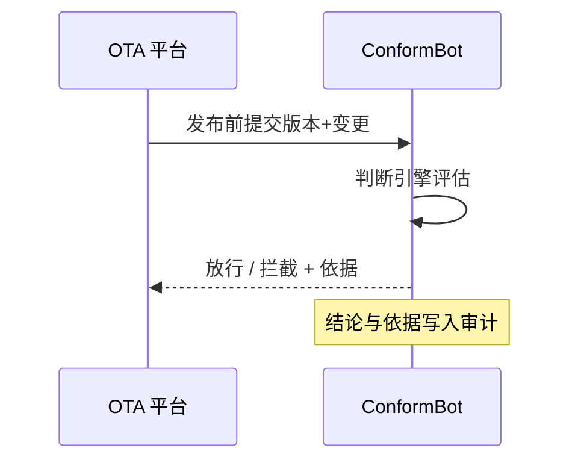

# 接口与协议规范

> 本文档定义 ConformBot 的对外接口与协议。微服务形态：**API / CLI / 极简 Web 均可能**（§11）。
> 标注 【源自项目文档】 源自早期规划文档（已并入本套文档；§ 指其原章节号）；具体接口签名为【建议/待确认】推演。

## 一、接口总览【建议/待确认】

| 接口族 | 方向 | 用途 |
| :--- | :--- | :--- |
| SBOM 导入 | 入 | 上传并解析 CycloneDX/SPDX，或 CSV/Excel |
| 变更事件 | 入 | 提交 OTA/升级/组件变更事件 |
| 判断结果 | 出 | 返回结构化合规结论（带依据） |
| 主动推送 | 出 | 事件驱动推送合规信号 |
| 集成对接 | 双向 | MCP(PLM) / hawkBit(OTA) / webhook |
| CLI / API | 双向 | 极轻命令式调用与程序化调用 |

## 二、SBOM 导入接口【源自项目文档】

**来源**：§10.1（CycloneDX/SPDX）、§10.2（MVP 手动导入）。

```http
POST /api/v1/products/{product_id}/sboms
Content-Type: multipart/form-data

file: <CycloneDX | SPDX | CSV | Excel>
format: cyclonedx | spdx | csv
firmware_version: "1.2.3"
```

**行为**：解析 → 提取安全相关子集（`04` §三）→ 组件规范化（版本到补丁级）→ 落库为「成分基线」。

**返回**：
```json
{
  "sbom_id": "sbom_001",
  "components": 42,
  "kept_security_subset": 17,
  "warnings": []
}
```

## 三、变更事件录入接口【源自项目文档】

**来源**：§9.3（变更事件触发判断）、§6.1③。

```http
POST /api/v1/products/{product_id}/changes
Content-Type: application/json

{
  "firmware_version": "1.2.4",
  "change_type": "component_upgrade",
  "changes": [
    { "component": "mbedtls", "from": "2.28.1", "to": "2.28.4" }
  ],
  "note": "本次 OTA 升级加密库"
}
```

**返回**：见 §四 判断结果。

## 四、判断结果接口【源自项目文档】

**来源**：§6.1③（结构化结论）、§7.4（多框架独立告警）。

```json
{
  "change_assessment_id": "ca_001",
  "touched": true,
  "touched_areas": ["crypto_lib", "auth_protocol"],
  "conclusion": "reassess",
  "nb_hint": "需向公告机构备案",
  "basis": [
    { "rule": "SCM-1", "standard": "EN 18031-1:2024", "note": "通信加密要求" }
  ],
  "alerts": [
    { "framework": "EN 18031", "ref": "GEC-1", "severity": "high" },
    { "framework": "CRA", "ref": "§14", "severity": "high" }
  ]
}
```

> ⚠️ `alerts` 数组**不做跨框架合并**：同一 CVE 触碰几个框架就有几条（`04` §八）。

## 五、主动推送协议【源自项目文档】

**来源**：§6.1②（按 BOM 过滤推送）、§7.4、§9.1（信号分级）。

**渠道**：webhook / 邮件 / 平台消息（建议）。

**信号分级严格**：日常输出形如「本周新增 2 个监控项，0 个需立即处理」，而非「⚠️ 新漏洞！」。

```json
{
  "event": "compliance_signal",
  "level": "watch | action_required",
  "summary": "本周新增 2 个监控项，0 个需立即处理",
  "items": [
    { "type": "cve", "id": "CVE-2026-xxxx", "status": "仅监控", "framework": "EN 18031" }
  ]
}
```

## 六、集成对接【源自项目文档】

**来源**：§10.2 分阶段对接策略。

| 目标 | 阶段 | 协议 | 说明 |
| :--- | :--- | :--- | :--- |
| PLM | 二 | **MCP** | 消费 beCPG 等已提供 MCP Server 的 PLM 数据 |
| OTA | 二 | **hawkBit REST API** | Eclipse hawkBit Management API（事实标准） |
| PLM/OTA | 三 | webhook / REST | 判断结果回写 ECN、OTA 发布前合规门禁 |

**发布前合规门禁（建议流程）**：



## 七、统一返回与错误码【建议/待确认】

```json
{ "code": 0, "message": "ok", "data": { } }
```

| code | 含义 |
| :--- | :--- |
| 0 | 成功 |
| 4001 | 入参非法（SBOM 缺字段 / 版本无法规范化） |
| 4002 | 格式不支持 |
| 4003 | 未找到产品/固件 |
| 5001 | 外部数据源不可用（NVD/KEV 等） |
| 5002 | 判据缺失（条款版本不可用） |

> 原则：**判据缺失时不得给出「合规」结论**，应返回待定并提示补全（延续「失败方向安全」思路）。

## 八、认证与权限【建议/待确认】

- 面向中小企业、低摩擦接入：首期以 API Key / Token 为主。
- 集成场景（PLM/OTA）使用独立凭据与最小权限。
- 所有写操作（导入、变更、门禁结论）须落审计（`04` §九）。
