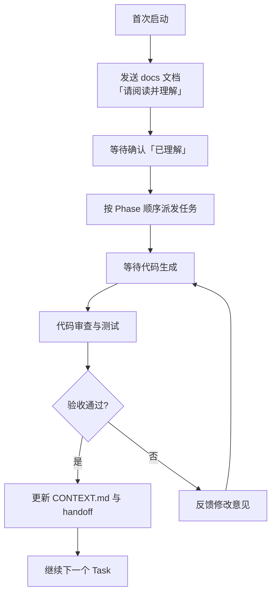

# 给 WorkBuddy 的执行指南

> 【建议/待确认】本指南定义如何向 AI 工具（WorkBuddy）派发本项目的开发任务。结构参照 `barkguard/docs/09-给WorkBuddy的执行指南.md`。

## 一、核心沟通原则

### 1.1 每次任务必须包含

1. **任务锚点**：`请继续 ConformBot（合规值守官）项目开发。`
2. **阶段编号**：`Phase X，Task Y：`
3. **具体指令**：从 `03-分阶段任务清单.md` 复制对应任务
4. **参考文档**：指明需要查阅的文档（判断逻辑用 `04`，接口用 `05`）

### 1.2 标准任务模板

```text
请继续 ConformBot（合规值守官）项目开发。
项目路径：D:\project\conformbot。

Phase 1，Task 1.1：CVE 多层过滤。
具体需求：
1. 按 04-数据模型与判断逻辑.md §四 实现四层过滤
2. 组件+版本精确匹配（到补丁级）
3. 公开利用证据判定（PoC/CISA KEV/在野）
4. 输出四态标签：必须修复/建议修复/仅监控/不适用
技术规范：
- 判据可版本化、结论必带 basis
- 判据缺失不得判「合规」，返回待定
- 有正/反单元测试（含版本不匹配排除）
参考文档：04-数据模型与判断逻辑.md、07-通用开发规范.md
请生成完整代码，包含文档注释。
完成后请提供文件清单和关键代码说明。
```

## 二、任务派发流程



## 三、各 Phase 启动指令

### Phase 0 启动

```text
请开始执行 Phase 0：地基（数据模型 + SBOM 导入）。
请按照 03-分阶段任务清单.md 中 Task 0.1 至 Task 0.3 的指令执行。
完成后请汇报：
1. 项目目录结构
2. 数据模型与审计哈希链验证结果
3. SBOM（CSV/CycloneDX/SPDX）导入结果
```

### Phase 1 启动

```text
Phase 0 已完成。请开始执行 Phase 1：判断引擎。
请按照 03-分阶段任务清单.md 中 Task 1.1 和 Task 1.2 的指令执行。
优先完成 Task 1.1（CVE 多层过滤），再做 Task 1.2（变更评估引擎）。
参考 04-数据模型与判断逻辑.md §四–§七。
```

### Phase 2 启动

```text
Phase 1 已完成。请开始执行 Phase 2：主动推送与看板。
请按照 03-分阶段任务清单.md 中 Task 2.1 至 Task 2.3 的指令执行。
重点：多框架独立告警不得合并；信号分级严格（日常静默）。
参考 04-数据模型与判断逻辑.md §八、06-客户端与交互设计.md。
```

### Phase 3 启动

```text
Phase 2 已完成。请开始执行 Phase 3：静默修复 + 语义级变更分析。
请按照 03-分阶段任务清单.md 中 Task 3.1 和 Task 3.2 的指令执行。
参考 02-开源项目与数据源整合清单.md §四/§八。
```

### Phase 4 启动

```text
Phase 3 已完成。请开始执行 Phase 4：对接与门禁。
请按照 03-分阶段任务清单.md 中 Task 4.1 至 Task 4.3 的指令执行。
参考 05-接口与协议规范.md §六。
```

## 四、单模块独立执行

示例：只做 CVE 多层过滤

```text
请单独执行 CVE 多层过滤模块。
输入：SBOM 组件集 + CVE 记录 + 条款库版本
输出：四态标签 + basis（条款/数据点/命中规则）
不依赖前端与推送，可独立测试。
参考 04-数据模型与判断逻辑.md §四–§五。
```

## 五、常见问题处理

### 5.1 上下文丢失

```text
请回顾 ConformBot 项目的完整上下文。
项目文档在 docs/ 目录下，状态快照在 CONTEXT.md。
当前进行到 Phase X，Task Y。请继续执行。
```

### 5.2 代码质量不达标

```text
代码存在以下问题，请按 07-通用开发规范.md 修改后重新提交：
1. 判断结论缺少 basis（条款版本/数据点/命中规则）
2. 判据缺失时错误地返回了「合规」
3. 缺少单元测试（多层过滤/版本匹配）
```

### 5.3 违反合规红线

```text
实现违反了合规红线：
1. 告警被跨框架自动合并（违反 04 §八），请改为每个框架各一条
2. 出现了「保证通过认证」类表述（违反 07 §七），请移除
参考 07-通用开发规范.md §七。
```

### 5.4 任务粒度过大

```text
请将 Task 2.3（合规看板）拆分为：
1. 健康度色标计算
2. 看板卡片/表格渲染
3. 与判断结果的联动
先完成第 1 项。
```

## 六、验收流程

每个 Task 完成后：

1. 代码审查：对照 `07-通用开发规范.md`。
2. 功能测试：按 `05-接口与协议规范.md` 验证接口。
3. 判断专项：对照 `08-验收清单.md` 的「判断准确性基准」。
4. 在 `08-验收清单.md` 勾选对应项。
5. 更新 `CONTEXT.md` 与 `docs/handoff/phase-N-complete.md`。
6. 回复「Task X.X 验收通过，继续下一个任务」。

## 七、文件管理建议

```text
D:\project\conformbot\
├── docs/
│   ├── README.md
│   ├── 01-项目概述与架构.md
│   ├── 02-开源项目与数据源整合清单.md
│   ├── 03-分阶段任务清单.md
│   ├── 04-数据模型与判断逻辑.md
│   ├── 05-接口与协议规范.md
│   ├── 06-客户端与交互设计.md
│   ├── 07-通用开发规范.md
│   ├── 08-验收清单.md
│   ├── 09-给WorkBuddy的执行指南.md
│   └── handoff/                 # 阶段交接文档
├── ingest/                      # 数据接入层
├── engine/                      # 判断引擎
├── store/                       # 数据模型与存储
├── push/                        # 主动推送
├── web/                         # 仪表盘前端
└── CONTEXT.md                   # 项目状态快照
```

每次任务前，确保 WorkBuddy 能访问 `docs/` 下的相关文档。
